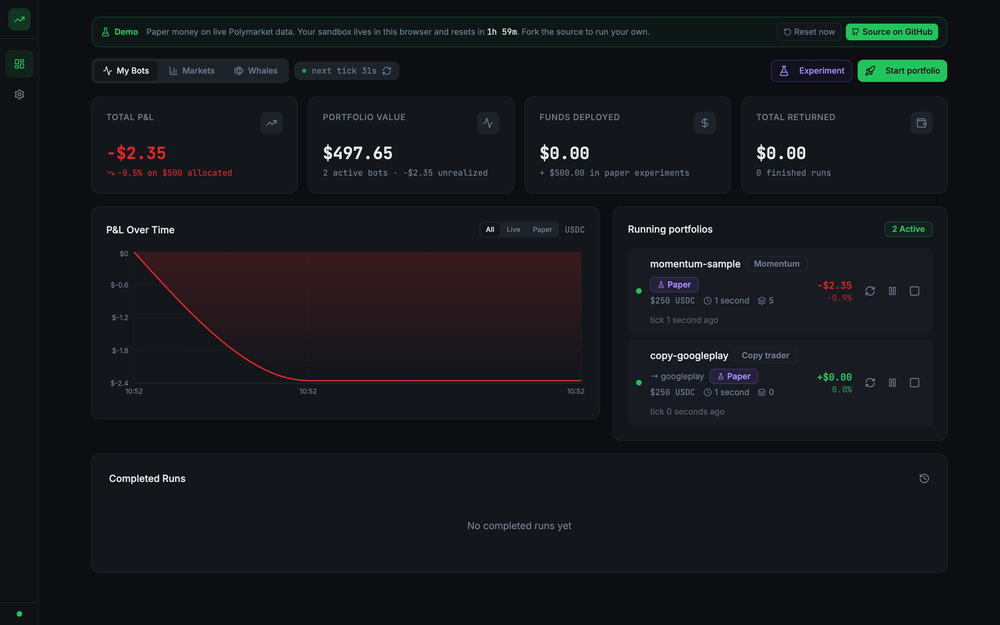
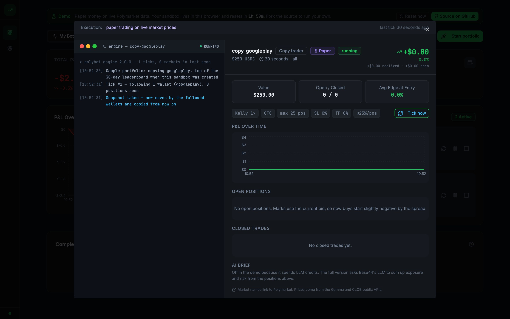
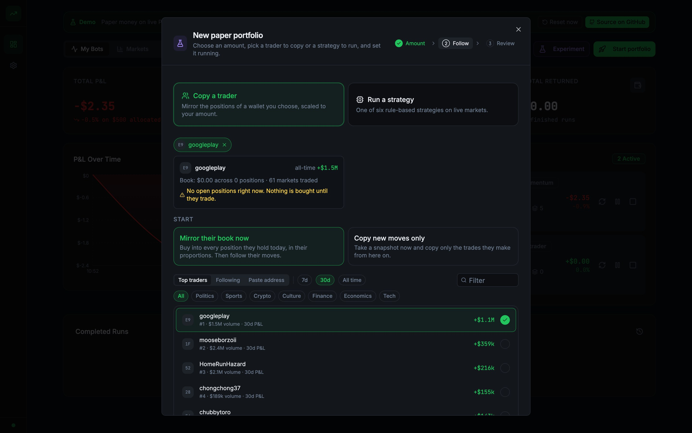
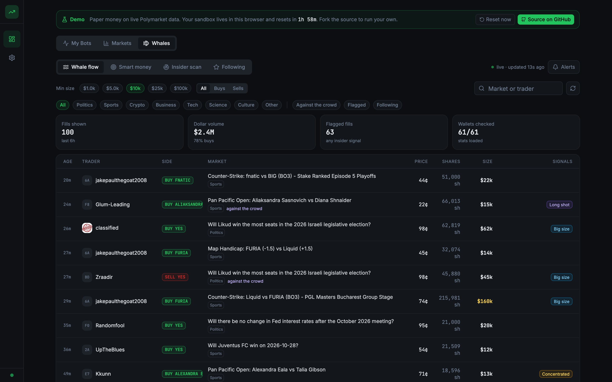
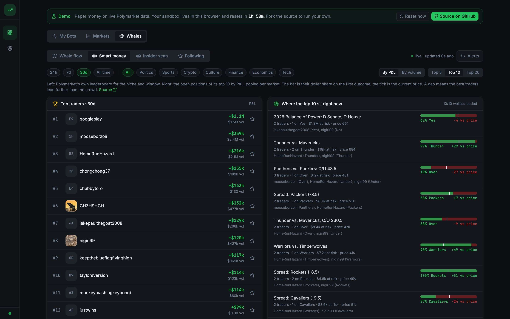
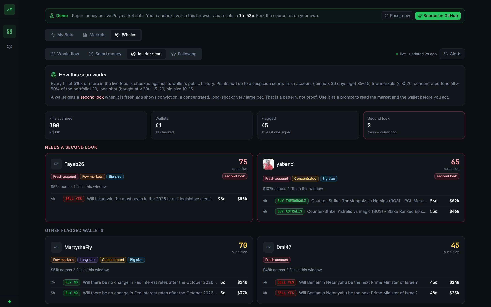
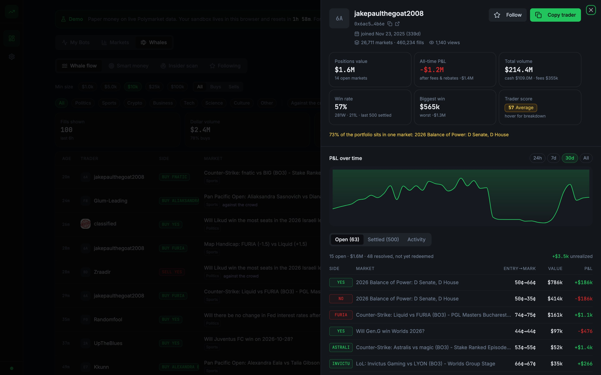
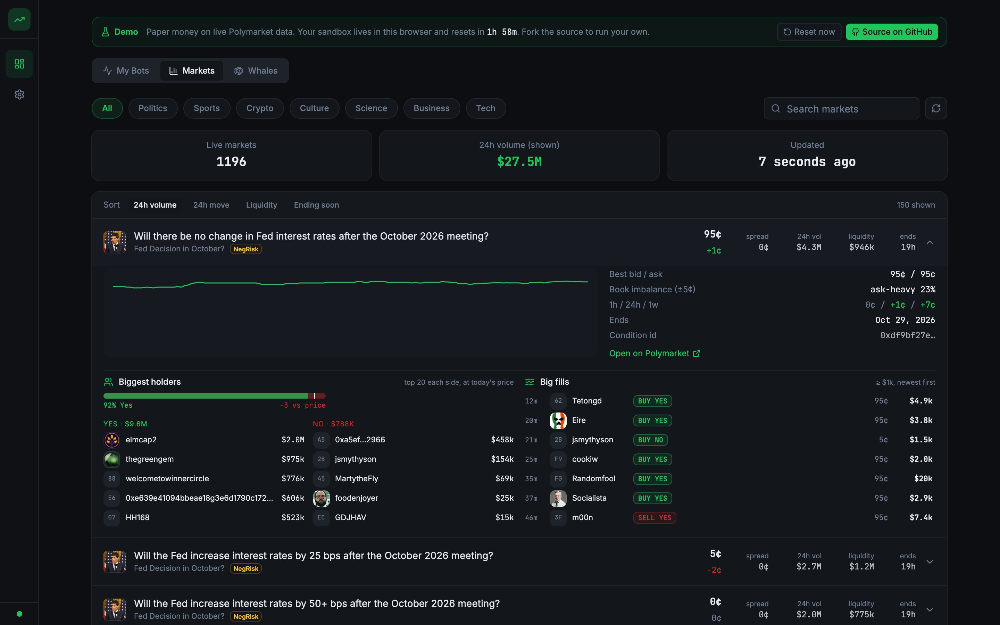

# PolyBot Terminal

An open-source autopilot for [Polymarket](https://polymarket.com).

Pick an amount. Pick a trader to copy, or a strategy to run. Start it. The app watches live Polymarket data every minute, copies the trader (or applies the strategy), prices every position, and closes positions when the trader sells or when your limits say so. Next to it, a whale tracker shows where big money and smart money is going, so you know who is worth copying.

**Try it now: [polymarket-trader-lac.vercel.app](https://polymarket-trader-lac.vercel.app).** No sign-up. Everyone shares one sandbox with paper money and two sample portfolios running on live data. A server ticks them every 5 minutes, and the sandbox resets every two hours. The hosted copy is a demo only. To run your own (private data, your own schedule), fork this repo. See [Run it yourself](#run-it-yourself) and [Deploy the free demo](#deploy-the-free-demo-vercel--supabase).

Right now the app **paper trades on real market data**. It reads real prices, order books, positions and wallets. It does not sign or send orders. "Live" portfolios track your real amount with simulated fills until a signer is connected (see [Live execution](#live-execution-status)).

## Screenshots

| | |
| --- | --- |
|  |  |
|  |  |
|  |  |
|  |  |

---

## What the app does

### Portfolios

1. **Amount.** Paper money, or a live amount checked against your real Polymarket balance.
2. **Follow.** Choose one of two paths:
   - **Copy a trader.** Pick up to three wallets from Polymarket's leaderboard (by topic and time window), from the wallets you follow, or by pasting an address. The wizard shows each wallet's open positions and what share of them your amount can copy.
   - **Run a strategy.** One of six rule-based strategies on live markets, by category.
3. **Review.** Name, how long to run (copy portfolios run until you stop them), position limits, and an optional stop-loss and take-profit. Then start.

Every running portfolio shows its P&L chart, open positions, closed trades, and a live log of what the engine did and why.

### Whales

This is where you find who to copy. It uses only Polymarket's public Data API.

- **Whale flow.** Every taker fill above a size you choose ($1k to $100k), live. You see the trader, side, price, size, market category and insider flags. Filters: side, category, "against the crowd", flagged, following.
- **Smart money.** The real leaderboard by topic (politics, sports, crypto, culture, finance, economics, tech) and time window. Next to it, a table of where its top traders sit right now: their open positions added up per market, how many of them hold it, and a bar that compares their dollar split with the market price.
- **Insider scan.** Each fill is checked against the wallet's public history. New accounts that make big, focused or long-shot bets get a "second look" tag. The rules are printed on the page. They are a reason to look closer, not proof.
- **Following.** Wallets you starred, each with all-time P&L, book value and latest fills.
- **Trader profile.** Click any trader anywhere in the app. You get join date, markets traded, book value, all-time P&L, cash volume, win rate, biggest win, a trader score, a P&L chart (24h, 7d, 30d, all), open positions, closed positions and on-chain activity. From here you can Follow, or press Copy trader to open the wizard with that wallet filled in.
- **Alerts.** While the app is open: a followed wallet trades, a suspicious new account bets, a big bet against the crowd, or a very large fill. A scheduled backend function stores the same signals every 5 minutes, so there is history when you come back.

### Markets and wallet

- **Markets.** A live list by category: YES price, 24h move, spread, volume, liquidity, time to resolution, 7-day price history, order-book imbalance, the biggest holders of each side, and the latest big fills in that market.
- **Wallet.** Save your Polymarket profile address to see your real USDC cash and position value. You can also connect a browser wallet (read-only). "Available" on the dashboard is your real cash minus what live portfolios have taken.

## How copy trading works

- Each trader you copy gets an equal share of your amount. **Scale** = your share divided by the trader's book value. So your positions keep the same proportions as theirs. $250 copying a $250,000 book holds 0.1% of each position.
- **Mirror their book now** buys into every position the trader holds at launch. **Copy new moves only** takes a snapshot and copies trades from then on.
- Every tick the engine reads the trader's positions and compares them with the last snapshot. A new or bigger position is bought at the live ask. A smaller one is cut by the same fraction. A closed one is sold. Partial sells get their own closed rows, so the record shows exactly what happened.
- Fills under $2 are skipped. So a small amount only copies the trader's biggest positions. The wizard shows how many positions clear that minimum.
- Positions close when the trader exits, when the market resolves, when the run ends, or when your own stop-loss or take-profit fires (off by default for copy portfolios).
- Limits: max positions (default 25) and max share of the amount in one position (default 25%). If the trader holds both sides of one market, the bot stays on the side it already holds.

## Strategies

| Strategy | Entry rule (live Gamma and CLOB data) | Exit rule |
| --- | --- | --- |
| **Momentum** | 24h move of 3¢ or more, with the 1h move in the same direction. Buy YES on up moves, NO on down moves. | 1h reversal of 3¢ or more, or stop/target |
| **Mean reversion** | 1h move of 4¢ or more in a liquid market. Buy the side that just got cheaper. | Half the move comes back, or stop/target |
| **Sentiment** | Order-book imbalance of 25% or more within 5¢ of the best price, scaled by the 24h volume spike. | Imbalance flips to −30% or worse, or stop/target |
| **Market making** | Deep markets with a spread of 2¢ or more. Join the bid on YES (passive fill assumed). | Bid reaches entry plus spread, or stop |
| **Arbitrage** | NegRisk events where every YES costs less than $1 in total (complete outcome sets only), or every NO costs less than $(n−1). Buy the whole basket. | Hold to settlement, or close early when the bids add up to the payout |
| **Custom** | Buy YES at or below your entry price. | Sell at your exit price, or stop |

Rules that apply to every strategy:

- Markets that end within 6 hours and in-play sports games are never traded.
- Stops and targets need a move of at least 2¢, so the spread alone cannot stop a position out. A stop or target of 0 means off.
- A market a bot exited is off limits to that bot for 6 hours.
- An entry is skipped if the fresh CLOB ask moved more than 5% above the scan price.
- Paper fills are taker fills: buy at the ask, sell at the bid. Open positions are priced at the bid, so a new position starts a little negative by the spread. That is on purpose.

These are simple, open rules for paper trading. They are not a claim that they make money.

### Sizing

Strategy positions use fractional Kelly. For a contract bought at price *p* with an estimated win chance *q*, full Kelly is *f\* = (q − p) / (1 − p)*. The bot's Kelly fraction (¼, ½, ¾, 1) scales that down. Every position is also capped at the bot's max share per position and at the cash it has left. Market-making quotes use half the per-position cap, since there is no edge estimate. Arbitrage baskets are risk free at entry, so they only respect the cap. Copy positions are sized by scale, as above.

## Whale signals, in the open

All of this is computed in `src/engine/wallets.js` from public data. Nothing is hidden.

**Trader score (0 to 100).** 40 points for profit (realized P&L divided by cash volume, from −20% to +20%). 20 for hit rate (share of closed positions that made money). 10 for profit factor (gross wins divided by gross losses, capped at 3). 10 for experience (markets traded, capped at 50). 10 for track record (account age, capped at one year). 10 for discipline (full marks when no market holds more than 25% of the book). Fewer than 5 closed positions means "Unrated".

**Insider flags.** Fresh account (joined 30 days ago or less: 35 points, 7 days or less: 45). Few markets (3 or fewer: 20). Focused (one fill is 50% or more of the book: 20). Long shot (bought at 30¢ or less: 15, at 15¢ or less: 20). Big size ($25k or more: 10, $100k or more: 15). "Second look" means fresh **and** at least one of the other flags.

**Lean and gap.** The biggest holders of each side (or the open positions of the top traders) are weighted by dollars. Across a whole market, the YES share equals the YES price exactly, because every $1 mints one YES and one NO. So `gap = whale YES share − price`. A positive gap means the whales lean YES more than the crowd does.

**Against the crowd.** A BUY at 30¢ or less, or a SELL at 70¢ or more.

**Wallet registry.** The live feed only sees the wallets behind the newest 100 big fills. The hosted demo's server goes much wider: every 5 minutes it reads every Polymarket fill of $1,000 or more, keeps one row per wallet (public stats, the last 100 settled positions, the open book, score and flags), checks new wallets as they appear and refreshes old rows daily. The Wallets tab lists them all, sorted by score, P&L, volume, fills seen, latest fill or suspicion, with filters for category, fresh accounts and "second look". The feed reads wallet stats from this registry too, so most wallets cost the browser no extra API call. Code: `supabase/functions/demo-wallets` and `registryFlags()` in `src/engine/wallets.js`.

## Live execution status

| Piece | Status |
| --- | --- |
| Market, wallet and fill data (Gamma, CLOB, Data APIs) | live |
| Paper trading and copy trading on real prices and books | live |
| Scheduled server ticks and whale scanner | Base44: `botTick` + `whaleScan` (`npx base44 deploy`); demo: `demo-tick` + `demo-whales` Supabase Edge Functions on pg_cron |
| Real wallet balances and positions | live, read-only |
| Order placement | **not connected** |

Real orders need an EIP-712 signature from a wallet key plus CLOB API credentials. That must live in a backend function, with the credentials stored as Base44 secrets, never in the browser. Until that signer exists, portfolios marked "Sim fills" never move money.

## Architecture

```
┌─────────────────────────────────┐        ┌──────────────────────────────────────┐
│  React + Vite frontend          │        │  Base44 backend                      │
│  src/                           │  SDK   │  entities: BotRun, Trade,            │
│  • Portfolios (wizard, bots)    │◄──────►│            WhaleSignal, User         │
│  • Whales / Markets / Settings  │        │  auth, per-user settings             │
│  • useBotEngine (1 min ticks)   │        │  functions/botTick   (Deno, 5 min)   │
│  • useTraders / useWhaleAlerts  │        │  functions/whaleScan (Deno, 5 min)   │
└───────────────┬─────────────────┘        └──────────────────┬───────────────────┘
                │ imports src/engine                           │ imports base44/shared/engine
                ▼                                              ▼
        ┌──────────────────────────────────────────────────────────────┐
        │  the engine  (plain JS, same files in both places)           │
        │  polymarketApi.js  Gamma / CLOB / Data API calls             │
        │  markets.js        normalize Gamma markets and events        │
        │  strategies.js     six strategies + copy, scan() / exits     │
        │  sizing.js         Kelly, caps, basket sizing                │
        │  tick.js           runTick(ctx): opens / sells / closes /    │
        │                    marks / bot patch; planCopyDeltas()       │
        │  engine.js         executeTick: fetch, runTick, write        │
        │  wallets.js        trader score, insider flags, lean, alerts │
        └──────────────────────────────┬───────────────────────────────┘
                                       │ HTTPS (public, CORS *)
                                       ▼
          gamma-api.polymarket.com · clob.polymarket.com · data-api.polymarket.com
          polygon RPC (publicnode / 1rpc / drpc) for USDC balances
```

- **Frontend.** React 18, Vite, Tailwind, shadcn/ui, TanStack Query, Recharts. Pages are in `src/pages`. Features are in `src/components/{dashboard,bot-setup,whales,markets}`.
- **Base44.** Hosting, login, the database (entities), scheduled functions and the LLM integration. The SDK client is `src/api/base44Client.js`. Entity schemas, with row-level security, are in `base44/entities/*.jsonc`.
- **Engine.** `src/engine` has no React and no SDK calls. `executeTick` takes an `api` adapter (`createTrades`, `updateTrades`, `updateBot`). The browser passes the user's client. The backend passes the service role. Base44's preview sandbox only serves `src/`, and backend functions can only import from `base44/shared/`. So the engine is edited in `src/engine` and copied to `base44/shared/engine` with `npm run engine:sync`. `npm run lint` fails if the two copies differ.
- **Demo mode.** `src/api/base44Client.js` exports a proxy. The app owner, signed in, gets the real Base44 client. Everyone else gets `src/api/localClient.js`, the same interface backed by the browser's localStorage, seeded by `src/lib/demoSeed.js` with two sample paper portfolios. The sandbox expires after two hours. Nothing in the demo costs money: Polymarket's APIs are public, there are no database writes, and the AI brief (the only paid call) is off. The switch happens in `src/lib/AuthContext.jsx` before any page renders. The owner signs in through the unlinked `/login` path.
- **Scheduler.** The browser hook ticks every 60 seconds while the dashboard is open. `botTick` runs every 5 minutes on the server. Whichever side ticked a bot in the last few minutes wins, so nothing is processed twice. `whaleScan` stores notable fills every 5 minutes.
- **Rate limits.** The Data API answers bursts with 429 errors. Wallet lookups go through a gate that allows 4 calls at a time (`createLimiter`), and `getJson` retries 429 and 5xx answers after a short pause.

### Data model

**BotRun** is one portfolio. Settings: `name, algorithm (momentum | mean_reversion | sentiment | market_making | arbitrage | custom | copy), categories, fund_allocation, duration_hours (0 = until stopped), is_paper, kelly_fraction, order_type, neg_risk, custom_params, max_positions, stop_loss_pct, take_profit_pct (0 = off), max_position_pct, copy_wallets [{ address, name, profileImage }], copy_mode (mirror | new_only)`. State written by the engine: `status, current_value, pnl, pnl_percent, realized_pnl, unrealized_pnl, positions_bought/sold, open_positions, avg_edge, markets_scanned, ticks, last_tick_at, last_error, pnl_history[], activity_log[], entry_cooldowns{}, copy_state{}`.

**Trade** is one lot. `bot_run_id, market_name, market_id (condition id), token_id, outcome (YES|NO), outcome_label, side (buy|sell), entry_price, quantity, size_usdc, status (open|closed), current_price, unrealized_pnl, exit_price, exit_time, exit_reason, pnl, edge_at_entry, est_prob, signal, signal_value, signal_reason, fill_mode, pilot_address, basket_id, basket_payout, market_url`. When a copy bot sells part of a lot, it creates a closed `sell` row for the part sold and shrinks the open lot.

**WhaleSignal** is one notable fill stored by `whaleScan`: the fill, its category, `kinds (whale | contrarian | insider)`, `flags`, `insider_score`, `suspicious`, and the wallet's age, market count, P&L and book value at scan time. Every signed-in user can read it. Only the backend writes it.

**User** has extra fields set through `auth.updateMe`: `polymarket_address, browser_wallet, wallet_balance, default_fund, default_algorithm, watched_wallets[], whale_alerts { minUsd, followed, insiders, contrarian }`.

## Project structure

```
base44/
  config.jsonc              app name + site build settings
  entities/                 BotRun, Trade, WhaleSignal, User schemas (+ rls)
  functions/botTick/        scheduled engine tick (entry.ts + function.jsonc)
  functions/whaleScan/      scheduled whale scanner
  shared/engine/            copy of src/engine for the backend (npm run engine:sync)
supabase/
  migrations/               shared demo sandbox schema, guard rails, reset (generated from the entity files)
  functions/demo-tick/      Edge Function: tick the shared sandbox every 5 minutes, seed it when empty
  functions/demo-whales/    Edge Function: store notable whale fills
  functions/*/engine/       copies of src/engine for the Edge Functions (npm run engine:sync)
  cron.sql                  pg_cron schedules (tick, whales, reset)
scripts/sync-engine.mjs     copies and checks both engine mirrors
scripts/gen-supabase-schema.mjs  entity files → Supabase migration
vercel.json                 static build settings for the demo
src/
  engine/                   the engine: polymarketApi, markets, strategies, sizing, tick, engine, wallets
  api/base44Client.js       Base44 SDK client
  api/polymarket.js         Polymarket API re-exports + formatting helpers
  lib/engine/useBotEngine.js  in-browser scheduler for the engine
  lib/useTraders.js         React Query hooks for fills, wallets, holders, leaderboards
  lib/useFollowing.js       followed wallets + alert settings (on the User record)
  lib/useWhaleAlerts.js     live alerts + stored signals
  lib/useUserProfile.js     user settings + live wallet funds
  lib/wallet.js             read-only Polygon and browser-wallet helpers
  api/localClient.js        browser-only client for demo mode (private sandbox)
  api/sandboxClient.js      Supabase-backed client for the shared demo sandbox
  lib/demoSeed.js           sample portfolios for a fresh demo sandbox
  pages/                    Dashboard, Settings
  components/layout/        side rail, demo banner
  components/bot-setup/     portfolio wizard, trader picker, strategy cards, risk controls
  components/dashboard/     stats, P&L chart, running portfolios, completed runs, detail modal
  components/whales/        whale flow, smart money, insider scan, following, alerts, trader drawer
  components/markets/       live market explorer (+ holders and big fills per market)
```

## Run it yourself

```bash
git clone https://github.com/JNamrow/polymarket-trader.git
cd polymarket-trader
npm install
```

**Frontend plus Base44 backend.** Create a free Base44 app, then:

```bash
npx base44 login      # once, opens the browser
npx base44 link       # writes the git-ignored base44/.app.jsonc for your app
npx base44 deploy -y  # pushes entities (with RLS) and both scheduled functions
npx base44 dev        # local backend + Vite dev server
```

`npm run build` builds the site. `npm run lint` runs ESLint and checks the engine mirror. `npm run engine:sync` refreshes the mirror after you edit `src/engine`.

**Engine without the UI.** `src/engine` runs in Node or Deno. Import `executeTick` from `src/engine/engine.js` and pass an in-memory `api` adapter, or call `runTick` with your own `ctx`.

## Deploy the free demo (Vercel + Supabase)

The public demo needs no Base44. It is a static build on Vercel's free plan plus a small Supabase project (free plan) that holds one shared sandbox. Total cost: zero.

**1. Supabase (the shared sandbox).**
- Create a project at supabase.com. In the SQL editor, run `supabase/migrations/20261028000000_demo_sandbox.sql`. It creates the tables, the guard rails (20 portfolios max, paper money only) and the `demo_reset()` function. Regenerate it with `npm run supabase:schema` after changing an entity. Then run `supabase/migrations/20261028120000_wallet_registry.sql`, which adds the wallet registry tables (hand-written, not generated).
- Deploy the three Edge Functions: `npx supabase login`, `npx supabase link --project-ref <ref>`, `npx supabase functions deploy demo-tick demo-whales demo-wallets --no-verify-jwt`. Each function folder carries its own copy of the engine (kept in sync by `npm run engine:sync`).
- Run `supabase/cron.sql` in the SQL editor after replacing `<PROJECT_REF>`. It generates a random token (kept in Vault and in a server-only table; nothing to paste), then schedules the tick, the whale scan and the wallet scan every 5 minutes, and the reset every 2 hours. The tick seeds two sample portfolios whenever the sandbox is empty, so visitors never see a blank screen.

**2. Vercel (the site).**
- Import the repository (Add New → Project → GitHub). Vercel reads `vercel.json`: Vite, `npm run build`, output `dist`, all routes to `index.html`.
- Set three environment variables: `VITE_APP_MODE=demo`, `VITE_SUPABASE_URL`, `VITE_SUPABASE_ANON_KEY` (Project Settings → API). Deploy. Every push to `main` redeploys.

**What visitors get.** A dashboard with the shared portfolios, live whale tracking, a Wallets tab with every wallet the server scan has seen, and the wizard. They can start paper portfolios in the shared sandbox (capped at 20). Their followed wallets and alert settings stay in their own browser. There is no sign-in and no way to create an account. The demo account holds $6,000 of paper money: $1,000 runs in the two sample portfolios (real paper trading on live prices) and the rest is free to allocate. The finished runs it starts with are synthetic examples, named `sample-…`, so the dashboard is not empty on day one. Without the two Supabase variables the demo still works: each visitor then gets a private sandbox in their own browser.

**How it is wired.** `VITE_APP_MODE=demo` makes `src/api/base44Client.js` skip Base44 entirely and use `src/api/sandboxClient.js` (Supabase, anon key, row-level security: read, create and update only) or `src/api/localClient.js`. In the shared sandbox the browser does not run the one-minute engine loop; the `demo-tick` function does, every 5 minutes, and the dashboard refreshes every 30 seconds. The "tick now", launch and stop actions still run the engine in the browser so changes show up at once.

## Base44 (optional backend)

This repository is no longer synced with a Base44 app. The free demo runs on Vercel and Supabase (see above). Base44 is still a supported backend for a private copy with saved data and server-side ticks:

- `npx base44 link` ties a clone to your own Base44 app. `npx base44 deploy` pushes the entity schemas in `base44/entities` and both scheduled functions. The local `function.jsonc` files are the source of truth. Changes made in the Base44 dashboard are overwritten on the next deploy.
- Base44 can sync a repository both ways (edits in the builder become commits, pushes to `main` reach the app). Turn it on from the app's Code page in Base44 if you want it. Only `main` syncs.
- For a public demo on Base44, the app must allow visitors without an account (App Visibility) and keep sign-up invite-only. The owner gets the full app; everyone else gets demo mode.

## Contributing

Issues and pull requests are welcome. Keep the engine pure (no React and no SDK calls in `src/engine`). Run `npm run lint` before you push. If you change a trading rule, update the README table it belongs to.

## Roadmap

- Backend signer: CLOB API key, secret and passphrase as Base44 secrets, EIP-712 order signing, and real GTC/FOK/FAK execution behind the existing `order_type` setting.
- Copy trading: per-trader weights, a cap on total exposure per market across traders, and a view of the trader's closed positions.
- Resolution tracking for closed but unsettled baskets, and redeem reminders.
- Email or push notifications from the stored signals.
- Backtests of each strategy against CLOB price history.

## Disclaimer

Prediction-market trading can lose money. The strategies and signals here are simple public rules meant for paper trading and research. Copying a wallet copies its losses as well as its wins. Nothing in this repository is financial advice.

## License

[MIT](LICENSE) © 2026 Jacob Namrow
